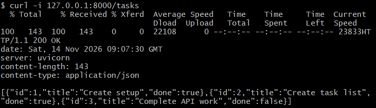

# fly-crudapi

## What this is
Simple CRUD API that manages a task list

You can create, read, update, and delete tasks

Data currently only lives in memory

## How to install and run it
To install just

```git clone https://github.com/monarchxr/fly-crudapi.git```

To run it

```uv run fastapi dev```

## Endpoints

| Endpoint 1 | Endpoint 2 | Endpoint 3| Endpoint 4 | Endpoint 5 | Endpoint 6 |
| ---------- | ---------- | --------- | ---------- | ---------- | ---------- |
| /health | /tasks | /tasks/{id} | /tasks/ | /stats | /reset |

## Sample curl output



## Swagger UI screenshot
